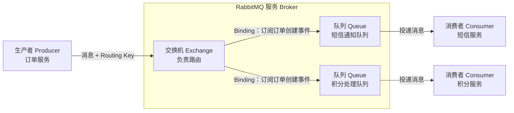
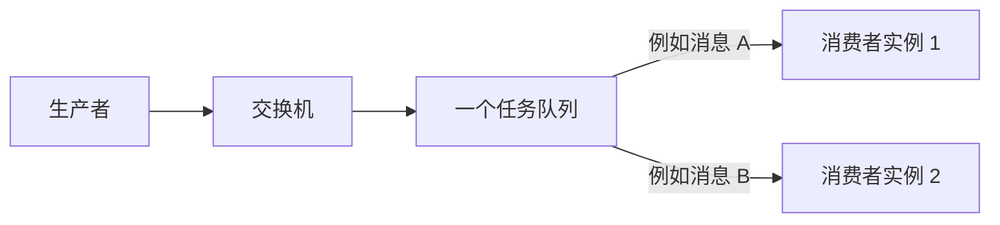
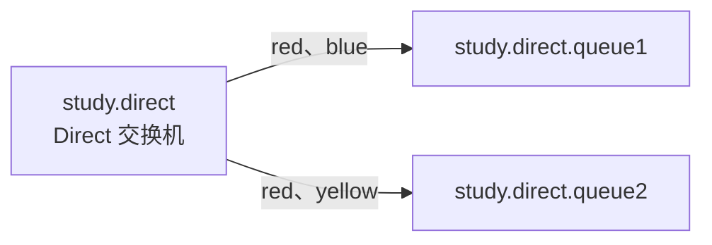
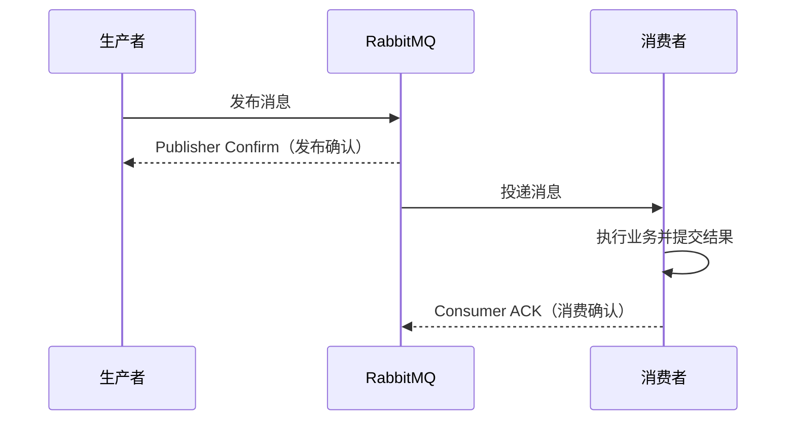

# RabbitMQ 入门：先看懂消息怎么走

适合第一次系统学习 RabbitMQ 的 Java / Spring Boot 开发者。建议先读第 1～6 节，再对照本项目代码阅读第 7～9 节，最后学习可靠性。

本文结合重构后的 Spring Boot 4.1.3 与 Spring AMQP 示例，使用 **AMQP 0-9-1 的交换机、绑定、队列模型**。RabbitMQ 支持多种协议；阅读其他协议的文档时，要注意模型差异。

## 1. 先用一张图建立整体认识

RabbitMQ 是消息中间件：生产者把消息交给它，它按规则把消息送入队列，再投递给消费者处理。



沿着箭头读：**订单服务发布“订单已创建”事件 → 交换机匹配路由规则 → 短信队列和积分队列各收到一份 → 两个服务分别处理。**

图中是逻辑关系：交换机和队列属于 RabbitMQ；生产者和消费者是你写的应用。同一个应用也可以同时发送和消费消息。

先记住四句话：

1. **生产者负责发消息。**
2. **交换机负责决定消息进入哪些队列。**
3. **队列负责保存待处理的消息。**
4. **消费者从队列接收消息并执行业务。**

这套模型中，消息发布给交换机；看起来“直接发给队列”的用法也经过默认交换机。交换机可以把消息路由到零个、一个或多个队列。[官方模型说明](https://www.rabbitmq.com/tutorials/amqp-concepts)

## 2. 为什么需要它？从下单场景理解

假设下单后需要创建订单、发短信、增加积分。

同步调用时，请求可能依次等待订单入库、短信接口、积分接口完成。短信接口变慢，会延长整个请求的响应时间。

引入消息队列后，可以让订单服务完成核心业务并可靠发布事件，再由短信服务、积分服务异步处理。用户收到“订单创建成功”时，短信和积分可能还在处理中。

| 用途 | 在这个例子中的体现 | 需要理解的边界 |
| --- | --- | --- |
| 异步处理 | 发短信、加积分在后台执行 | 用户不会立即拿到所有后续处理结果 |
| 服务解耦 | 订单服务发布事件，其他服务订阅 | 双方仍需约定事件内容和含义 |
| 削峰缓冲 | 消息先排队，消费者按处理能力消费 | 队列容量有限，持续处理不过来仍会积压 |

如果某个结果必须立即决定下单能否成功，就要单独设计该步骤的同步校验或业务流程。例如，需要严格防止超卖时，不能仅凭“消息已发出”就认定库存扣减成功。

## 3. 核心术语：分别负责什么

| 名称 | 含义 | 类比 |
| --- | --- | --- |
| Producer / Publisher | 发送消息的程序 | 寄件人 |
| Message | 消息体和属性，例如订单 ID、事件 ID | 包裹及其标签 |
| Broker | RabbitMQ 服务 | 快递中转站 |
| Exchange | 按规则把消息路由到队列 | 分拣中心 |
| Queue | 保存消息，等待投递和处理 | 待取件区域 |
| Consumer | 接收并处理消息的程序 | 收件人 |
| Binding | 交换机与队列之间的绑定关系 | 分拣规则 |
| Routing Key | 生产者发布消息时携带的路由键 | 包裹上的分类标签 |
| Binding Key | 绑定时配置的匹配键或模式 | “接收哪些分类”的规则 |

例如生产者发送 `order.created`，队列可以使用同名绑定键接收它，也可以在 Topic 交换机下使用 `order.*` 匹配它。**Routing Key 是消息携带的值，Binding Key 是订阅规则。**

再认识三个基础设施名词，暂时不用背配置：

- **Connection**：应用与 RabbitMQ 之间的网络连接。
- **Channel**：连接中承载发布、消费、确认等操作的逻辑通道，一个连接可承载多个通道。
- **Virtual Host（vhost）**：RabbitMQ 内的逻辑隔离空间，交换机、队列和权限在其中管理；它不代表独立机器或独立资源配额。

上述术语属于本文使用的 AMQP 模型。[官方术语与模型](https://www.rabbitmq.com/tutorials/amqp-concepts)

## 4. 一条消息的完整旅程

以订单事件为例，消息体可以这样设计；字段是教学示例：

```json
{
  "eventId": "evt-10001",
  "eventType": "order.created",
  "orderId": "order-10001",
  "userId": "user-88"
}
```

1. 应用声明交换机、队列及绑定，使接收路径就绪。
2. 订单服务完成订单创建，准备发布事件。
3. 生产者指定交换机和 Routing Key，例如 `order.events`、`order.created`。
4. 交换机根据类型和绑定规则，把消息路由到匹配的队列。
5. 没有消费者在线时，消息可以留在已有队列中等待，具体还受 TTL、容量和队列生命周期等配置约束。
6. RabbitMQ 向订阅队列的消费者投递消息，消费者执行业务。
7. 使用需要确认的消费模式时，消费者完成处理后发送 ACK，RabbitMQ 才将该投递视为已处理。

**发布成功和业务处理完成是两个不同阶段。** 发布确认关注生产者到 RabbitMQ；消费确认关注 RabbitMQ 到消费者。[确认机制说明](https://www.rabbitmq.com/docs/confirms)

## 5. 最容易混淆：任务分担和发布订阅

### 5.1 一个队列，多个消费者：分担任务



例如两个短信服务实例监听同一个短信队列，用来共同处理短信任务。一次正常投递会选择其中一个消费者，**不会因为有两个消费者就广播两份**。失败后重新投递时，同一条消息仍可能再次被处理。

图中的 A、B 只是举例，不能据此推断固定分配顺序或两个实例一定各处理一半。预取数量、处理速度等都会影响实际分配。[官方工作队列教程](https://www.rabbitmq.com/tutorials/tutorial-two-java)

### 5.2 多个业务都要收到：各自使用队列

短信服务和积分服务都需要处理订单创建事件，就像第 1 节的图一样，分别建立短信队列、积分队列，并让它们都匹配该事件。

如果它们共同监听同一个队列，就会争抢消息，不能保证两种业务都执行。**队列之间实现各收一份，队列内部的消费者分担任务。** 两种方式可以组合：短信队列后面也可以有多个短信服务实例。[官方发布订阅教程](https://www.rabbitmq.com/tutorials/tutorial-three-java)

## 6. 交换机的四种类型

| 类型 | 如何选择队列 | 例子 |
| --- | --- | --- |
| Direct | Routing Key 与 Binding Key 精确匹配 | `order.created` 匹配 `order.created` |
| Fanout | 发给所有绑定到它的队列，忽略 Routing Key | 广播一条通知 |
| Topic | 用点分词和通配符匹配 Routing Key | `order.*` 匹配 `order.created` |
| Headers | 根据消息 headers 和绑定参数匹配 | 按多个头部属性筛选 |

Direct 也可以让多个队列各收到一份：只要它们都绑定了相同的匹配键。类型决定路由方式，不决定消费者数量。[交换机类型说明](https://www.rabbitmq.com/tutorials/amqp-concepts)

Topic 的两个通配符用在绑定规则中：`*` 匹配恰好一个词，`#` 匹配零个或多个词，词之间使用 `.` 分隔。

| Binding Key | Routing Key | 是否匹配 |
| --- | --- | --- |
| `order.*` | `order.created` | 是 |
| `order.*` | `order.payment.success` | 否，有两个后缀词 |
| `order.#` | `order.payment.success` | 是 |
| `order.#` | `order` | 是，`#` 可以匹配零个词 |
| `#.news` | `china.news` | 是 |

初学时先掌握 Direct、Fanout、Topic。[官方 Topic 教程](https://www.rabbitmq.com/tutorials/tutorial-five-java)

## 7. 对照重构后的项目学习

当前项目使用 Spring Boot 4.1.3、Java 17、Spring AMQP，提供工作队列、Direct、Fanout、Topic 四组 HTTP 实验。学习路径：

1. 阅读 `config/RabbitTopologyConfig.java`，看交换机、队列和绑定如何声明。
2. 阅读 `web/MessageController.java`，看一次发送请求指定了哪个交换机与 Routing Key。
3. 阅读 `messaging/MessagePublisher.java`，看 `RabbitTemplate` 如何发送并等待发布确认。
4. 阅读 `consumer/LearningConsumers.java`，看 `@RabbitListener` 如何监听队列。

这些 Java 路径相对于 `src/main/java/com/zjq/rabbitmq/`。MQ 消息先使用字符串，HTTP 请求体由 Spring Boot 自动解析为 Java record，便于把第一轮注意力放在消息流转上。

本项目的 Direct 绑定关系：



发送 API 的关键参数：

```java
// 三个参数依次是：交换机名称、Routing Key、消息体。
rabbitTemplate.convertAndSend("study.direct", "blue", "hello");

// 默认交换机：交换机名为空字符串，Routing Key 使用队列名。
rabbitTemplate.convertAndSend("", "study.work.queue", "hello");
```

上面展示最基础的发送方式。项目的实际生产者还设置消息 ID、持久化标记，并结合 Confirm 和 Return 判断发布结果。[Spring AMQP 发送 API](https://docs.spring.io/spring-amqp/reference/amqp/sending-messages.html)

## 8. 从四组实验开始动手

按照[实验手册](docs/labs.md)启动 RabbitMQ 和 Java 应用。交换机、队列与绑定全部由应用声明，不需要先手动创建。

| 实验 | HTTP 接口 | 观察重点 |
| --- | --- | --- |
| 工作队列 | `POST /api/messages/work` | 一个队列的两个消费者如何分担任务 |
| Direct | `POST /api/messages/direct?routingKey=red` | 精确匹配时，两个队列如何各收一份 |
| Fanout | `POST /api/messages/fanout` | 消息如何广播到所有绑定队列 |
| Topic | `POST /api/messages/topic?routingKey=china.news` | `china.#`、`#.news` 如何匹配 |

所有接口的请求体形如 `{"text":"hello RabbitMQ"}`。HTTP 返回 `202` 与 `BROKER_CONFIRMED` 代表发布确认成功，消费者执行情况看应用日志。

## 9. 先预测，再观察

| 操作 | 先预测的结果 |
| --- | --- |
| 向 `study.direct` 发 `blue` | `study.direct.queue1` 收到 |
| 向 `study.direct` 发 `red` | 两个 Direct 队列各收到一份 |
| 向 `study.direct` 发 `yellow` | `study.direct.queue2` 收到 |
| 向 `study.topic` 发 `china.good` | `study.topic.queue1` 收到 |
| 向 `study.topic` 发 `china.news` | 两个 Topic 队列各收到一份 |
| 两个消费者监听同一个工作队列 | 分担消息，不是各收完整一份 |
| 关闭消费者但保留队列并继续发布 | 无过期、容量等限制影响时，消息等待消费 |

在管理界面观察 `Ready` 和 `Unacked`：前者是等待投递的消息，后者是已投递但尚未确认的消息。消费者处理很快时，两者可能很快归零。[官方工作队列教程](https://www.rabbitmq.com/tutorials/tutorial-two-java)

## 10. 第二轮再学：消息可靠性

### 10.1 两种确认分别解决哪一段问题？



图中用顺序帮助区分职责；实际消费者可能在生产者收到 Confirm 前就收到消息，两种确认互相独立。

- **Publisher Confirm**：RabbitMQ 按相应队列类型的确认条件确认发布；不代表消费者已经执行业务。
- **Consumer ACK**：告诉 RabbitMQ 此次投递已处理，可以移除相应消息。
- **无法路由的消息**：即使没有匹配队列，也可能收到发布 ACK；需要结合 `mandatory` 和 Return 处理来发现这类情况。

[官方确认机制说明](https://www.rabbitmq.com/docs/confirms)

Spring 监听容器的 `AUTO` 模式由容器根据监听方法的执行结果发送确认，通常在方法正常返回后确认；它不同于 RabbitMQ 协议层“投递后无需等待处理结果”的自动确认。`MANUAL` 则需要应用显式确认。学习时务必区分这两种“自动”。[Spring 监听容器确认模式](https://docs.spring.io/spring-amqp/reference/amqp/containerAttributes.html)

### 10.2 处理失败或重复消息怎么办？

消费者处理失败时，可以配置重试；拒绝消息时可以选择是否重新入队。无限重新入队会造成反复失败，应设计重试上限及失败后的处理方式。配置死信交换机并满足触发条件后，失败或过期消息等可以转入死信处理路径。**抛出异常并不会自动创建死信队列。** [官方死信说明](https://www.rabbitmq.com/docs/dlx)

还要考虑这样的情况：消费者已经成功增加积分，但 ACK 尚未被 RabbitMQ 收到，连接就断开了。消息可能重新投递，积分逻辑就可能执行第二遍。

因此消费者需要**幂等性**：同一个业务事件重复到来，业务结果仍符合“只生效一次”的要求。例如用 `eventId + 业务处理类型` 建立唯一约束，并让去重记录与积分变更处于同一数据库事务中。对外部短信、支付等调用，还需要相应接口的幂等机制。具体方案取决于业务存储和接口能力。[RabbitMQ 可靠性说明](https://www.rabbitmq.com/docs/reliability)

### 10.3 保存下来，也不等于解决全部可靠性问题

持久化队列和持久化消息是基础；还需要发布确认、失败重发和正确的消费确认。节点故障容错则需另外理解副本队列等机制。普通队列也不是消费后可以任意回放的事件日志。[官方工作队列持久化教程](https://www.rabbitmq.com/tutorials/tutorial-two-java)

订单入库和发布消息之间也有故障窗口：订单已提交，应用却在发布前退出。RabbitMQ 的发布确认不能替你把两个系统的写入变成同一笔事务。可以继续学习本地消息表 / Transactional Outbox：把业务变更和待发事件放进同一个数据库事务，再可靠发送；重复发送仍由消费端幂等处理。[可靠性边界参考](https://www.rabbitmq.com/docs/reliability)

## 11. 学到什么程度算第一轮完成？

先尝试不看文档回答：

1. 交换机和队列分别负责什么？
2. Routing Key 和 Binding Key 有什么区别？
3. 两个消费者监听同一个队列，会各收到一份吗？
4. 短信和积分都需要处理订单事件，为什么要建立两个队列？
5. `order.*` 和 `order.#` 匹配的范围有什么不同？
6. 发布确认是否表示业务处理成功？

参考答案：交换机负责路由、队列保存消息；前者是发送值、后者是绑定规则；同队列消费者分担任务；两个队列让两种业务各获得一份；`*` 匹配一个词而 `#` 匹配零个或多个词；发布确认不表示消费业务已经完成。

建议学习顺序：**消息路径 → 同队列分担 / 多队列订阅 → 三种常用交换机 → 当前 Spring 示例 → 确认、重试、死信和幂等 → 持久化与高可用。**
